# İşletme Yönetim Sistemi Paneli · ERP

> **EN —** A full ERP/MES web application built for a CNC machining shop. It covers CRM, cost-based
> quoting, orders, work orders and routing, capacity planning, MRP/BOM, quality and scrap, delivery,
> stock, invoicing, finance, bookkeeping and HR: more than 30 modules on one database. Built with
> Next.js 16, React 19, Prisma and PostgreSQL. **This repository is a showcase:** it holds screenshots and a
> description. The source code is private. Everything shown is made-up demo data.

Bir CNC talaşlı imalat firmasının bütün işleyişini tek sistemde toplayan bir web uygulaması: tekliften
faturaya, tezgâhtan muhasebeye kadar. Atölyenin gerçek ihtiyaçlarından doğdu, o yüzden sektöre özgü kavramlar
sistemin içinde. Parça boyu, işleme süresi, çubuk boyu, malzeme cetveli, talaş ve hurda iadesi, fason kaplama
bunlardan birkaçı.

**Durum:** Ana akış tamamlandı, geliştirme sürüyor.

> **Bu depo bir vitrin.** Kaynak kod özel, burada yalnız sistemin tanıtımı ve ekran görüntüleri var.
> Görüntüler ayrı bir demo hesabından alındı. Firma, kişi ve tutarların hepsi **uydurma demo verisi**.

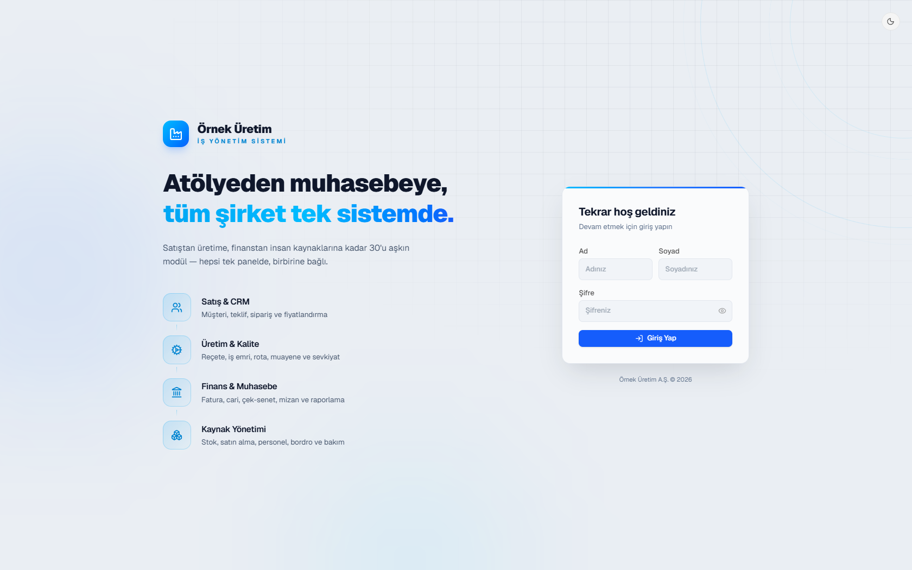

## Ana akış

```
CRM ─▶ Teklif ─▶ Sipariş ─▶ İş Emri ─▶ Kalite ─▶ Teslimat ─▶ Fatura ─▶ Finans
                    │           │
                    ▼           ▼
                MRP / BOM   Kapasite takvimi
                    │
                    ▼
            Stok · Satın alma
```

Her adım bir öncekinden beslenir. Teklif onaylanınca siparişe, sipariş iş emrine dönüşür. Sevk edilen
miktar irsaliyeye, irsaliye faturaya, fatura cari bakiyeye ve nakit durumuna yansır.

## Modüller

11 grup altında 30'u aşkın modül:

| Grup | Neler var |
|---|---|
| **Satış** | Müşteri ve tedarikçi kartları (CRM, cari 360° görünüm) · maliyet motorlu teklif (revizyon, PDF) · sipariş yaşam döngüsü · şikâyet ve iade |
| **Üretim** | Üretim takip panosu (kanban) · iş emri ve rota (operatör bildirimi, şef onayı) · MRP ve ürün reçetesi (BOM) · kapasite takvimi (makine doluluğu, Gantt) · kalite kontrol ve fire |
| **Lojistik** | Teslimat ve irsaliye, kısmi sevk, zamanında teslim oranı |
| **Stok** | Hammadde ve ürün kartları, lot ve stok hareketleri · kesici takım ve sarf · satın alma talepleri |
| **Finans** | Nakit ve cari durum, vade takibi · hızlı masraf fişi · fatura (irsaliyeden faturalama) · çek ve senet · SGK ve vergi takvimi · muhasebe programına Excel aktarımı |
| **Muhasebe** | Tek düzen hesap planı · mahsup, tahsilat, tediye ve virman fişleri · mizan · cari hesap kodu eşleme |
| **Varlık** | Makine parkı ve bakım · demirbaş · teknik çizim arşivi |
| **İK** | Özlük dosyası, puantaj · vardiya ve izin · maaş, avans ve mesai |
| **Raporlar** | KPI paneli · raporlar (Excel'e aktarım) · patron ekranı (yönetici özeti) |
| **Sistem** | Roller ve yetki · firma ayarları · yedekleme · işlem kaydı (log) · maliyet hesaplama ayarları |
| **Canlı izleme** | Tezgâh durumu ve kamera ekranları (geliştirme aşamasında) |

Bunlara ek olarak sistemin içinde bir **yapay zekâ asistanı** (Google Gemini) da var.

## Ekran görüntüleri

| | |
|---|---|
| 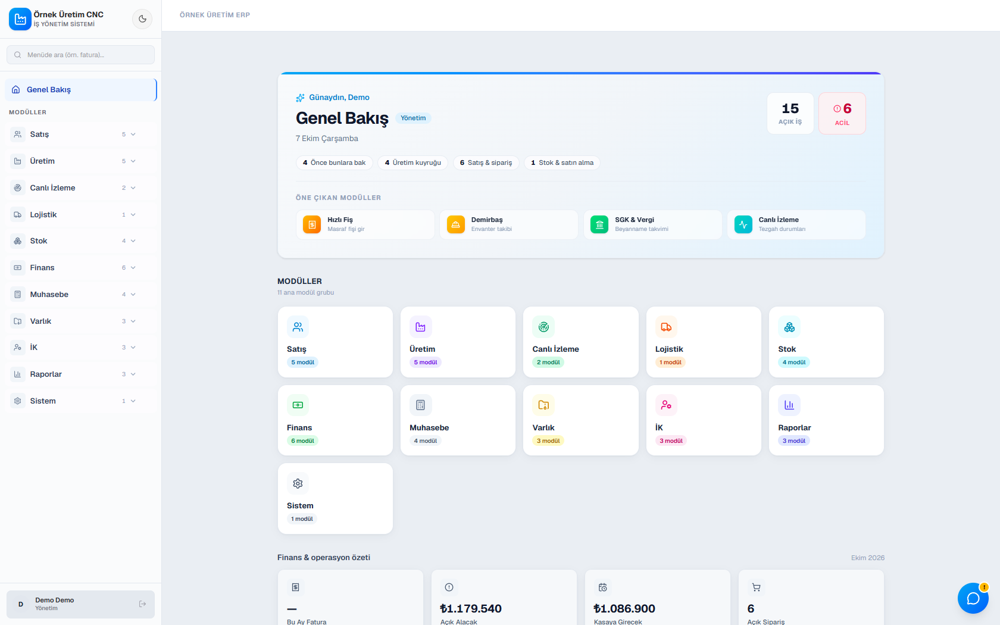 | 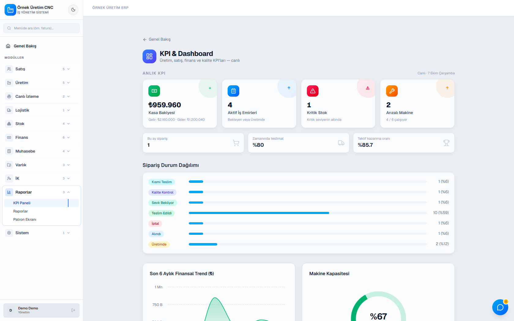 |
| **Genel Bakış:** günün açık işleri, modül grupları | **KPI paneli:** kasa, aktif iş emri, kritik stok, sipariş dağılımı |
| 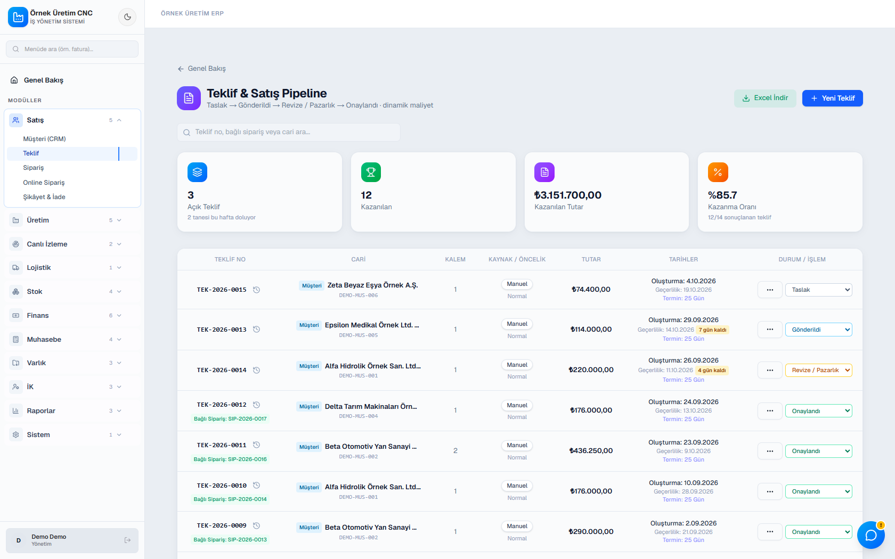 | 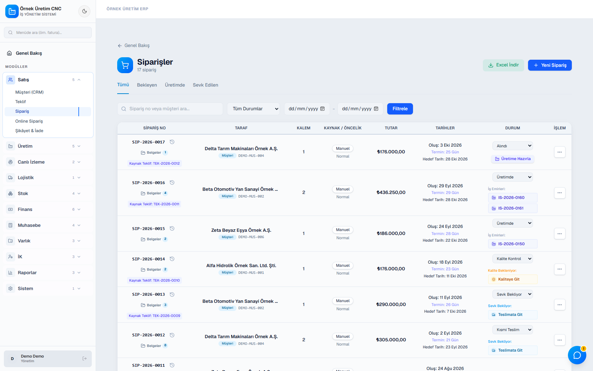 |
| **Teklif:** kazanma oranı, geçerlilik ve termin takibi | **Siparişler:** durum, termin, bağlı iş emirleri |
| 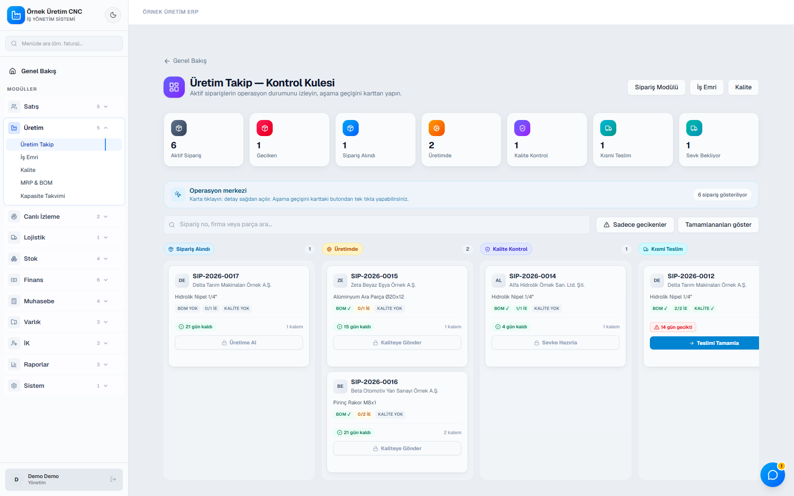 | 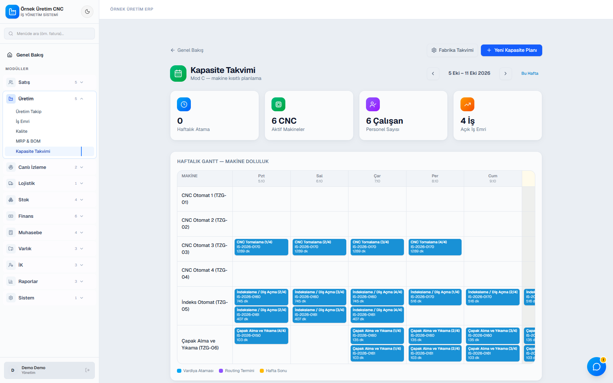 |
| **Üretim takip:** siparişler aşama aşama kanban panosunda | **Kapasite takvimi:** haftalık makine doluluğu |
| 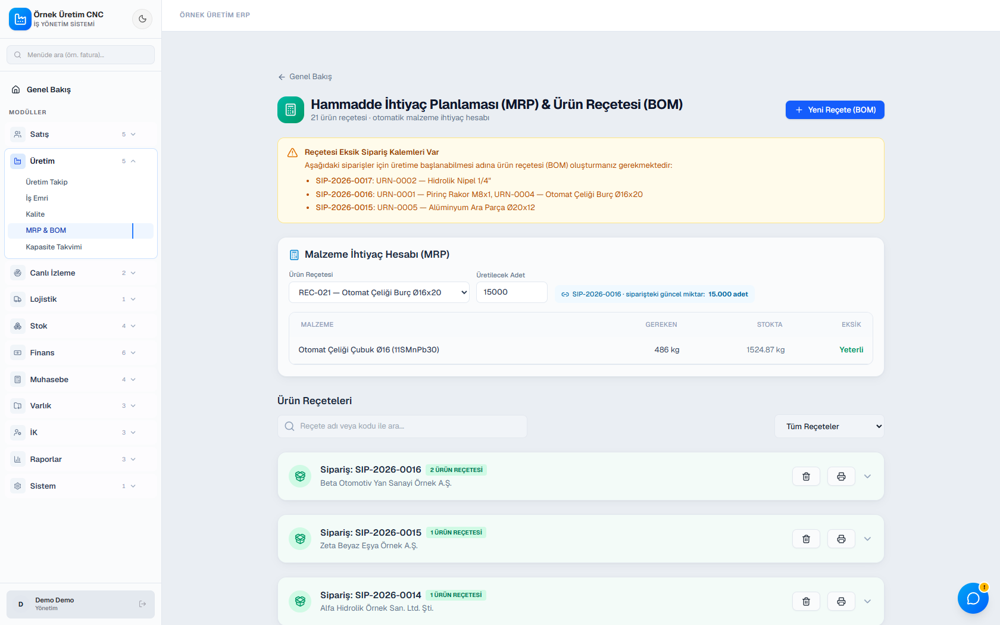 | 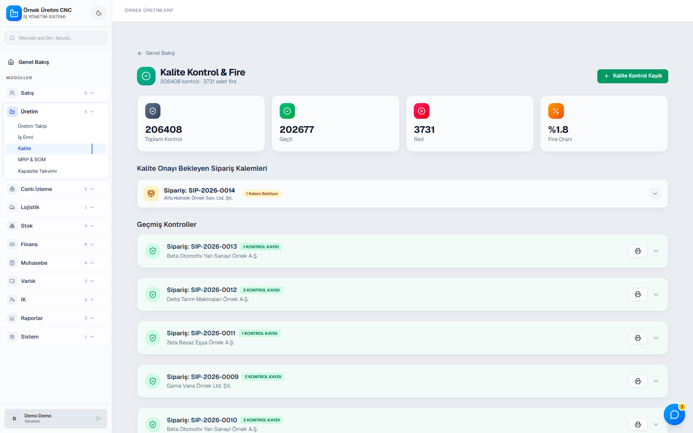 |
| **MRP ve BOM:** reçeteden hammadde ihtiyacı | **Kalite ve fire:** kontrol kayıtları, fire oranı |
| 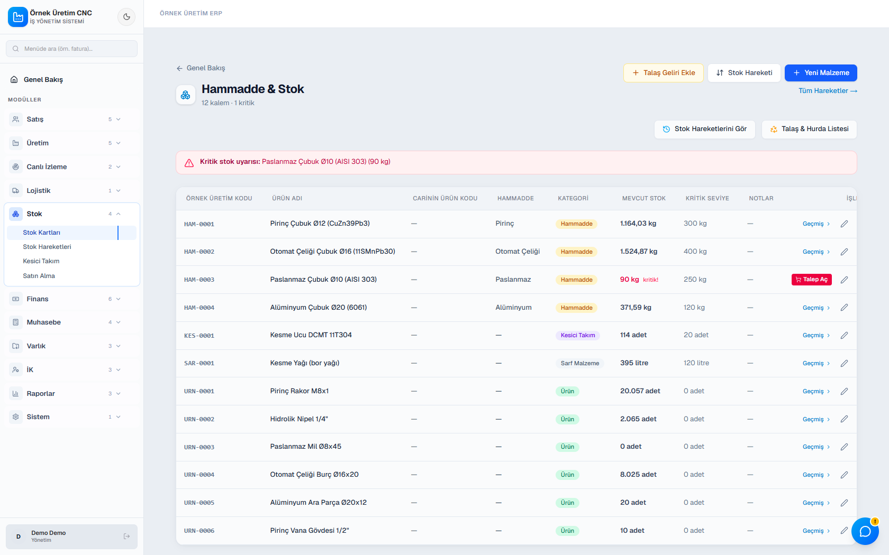 | 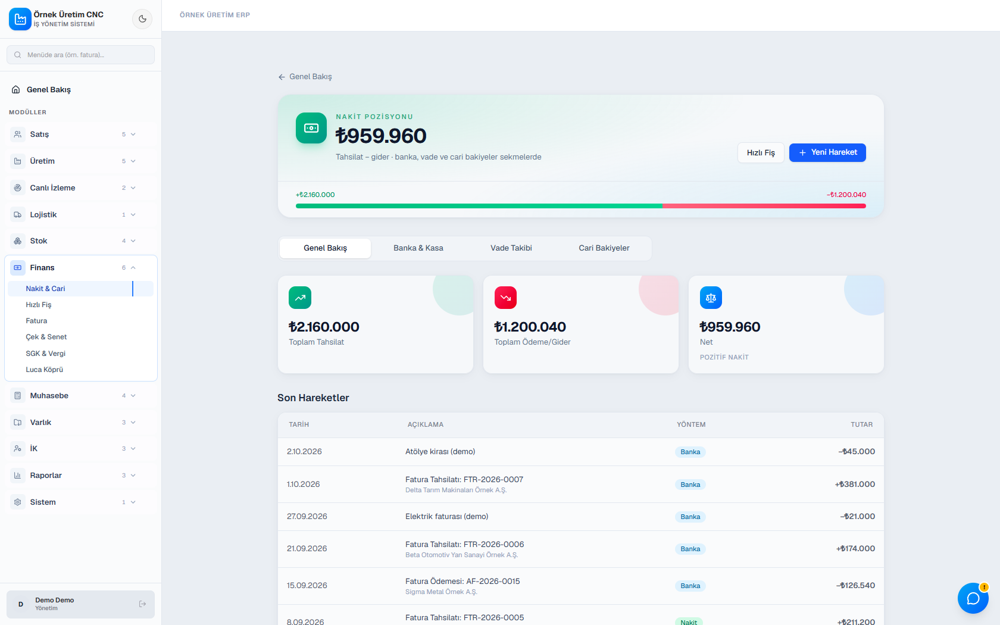 |
| **Stok:** hammadde ve ürün kartları, kritik seviye uyarısı | **Finans:** nakit pozisyonu, son hareketler |
| 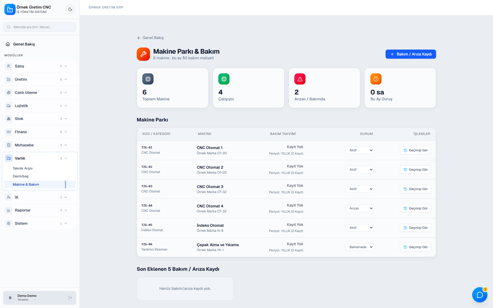 | |
| **Makine parkı ve bakım** | |

## Teknik

| Katman | Teknoloji |
|---|---|
| Uygulama | Next.js 16 (App Router, Server Components, Server Actions) |
| Arayüz | React 19 · Tailwind CSS 4 · recharts · sürükle-bırak kanban |
| Veri | Prisma 6 · PostgreSQL · Zod 4 ile doğrulama |
| Belge | PDF (jsPDF, pdf-lib) · Excel (ExcelJS) |
| Yapay zekâ | Vercel AI SDK + Google Gemini |

Ölçek: 63 veri modeli, yaklaşık 70 bin satır TypeScript.

```
┌───────────────────────────────────────────────┐
│  Tarayıcı · React 19 + Tailwind               │
└───────────────────────┬───────────────────────┘
                        │  Server Actions / API
┌───────────────────────▼───────────────────────┐
│  Next.js 16 sunucusu                          │
│   ├─ oturum ve rol denetimi (her sayfa, her işlem)
│   ├─ iş kuralları: maliyet motoru, stok, bakiye, numaralandırma
│   └─ PDF / Excel üretimi · yapay zekâ asistanı │
└───────────────────────┬───────────────────────┘
                        │  Prisma
                ┌───────▼───────┐
                │  PostgreSQL   │
                └───────────────┘
```

## Mühendislik notları

- **Yetki tek yerden tanımlı.** Hangi rolün hangi modülü görüp değiştirebileceği tek bir dosyada tutulur
  ve her sayfada ve her sunucu işleminde sunucu tarafında denetlenir. Roller şunlar: yönetim, muhasebe,
  üretim şefi, depo, operatör, izleyici.
- **İstemciye güvenilmez.** Teklif toplamları sunucuda yeniden hesaplanır. Formdan gelen tutar kaydın kaynağı olmaz.
- **Para ondalık türde tutulur.** Tutarlar veritabanında `Decimal` olarak saklanır, kayan nokta yuvarlama hatası olmaz.
- **İmzalı oturum ve işlem kaydı.** Oturum belirteci HMAC ile imzalanır. Girişler ve işlemler log modülüne düşer.
- **İzole demo hesabı.** Demo kullanıcısı yalnız demo kayıtlarını görür ve yazar. Bu depodaki görüntüler o hesaptan alındı.
- **Belge numaraları seri.** Siparişler, teklifler ve iş emirleri yıla göre sıra numarası alır
  (ör. `SIP-2026-0017`, `TEK-2026-0015`).

## İletişim

Kaynak kod özel. Benzer bir sistem ya da firmanıza özel bir yazılım için yazabilirsiniz:
**[emirdeniz997@gmail.com](mailto:emirdeniz997@gmail.com)**

## Haklar

© 2026 Emir Engin Deniz. Tüm hakları saklıdır. Ekran görüntüleri yalnız tanıtım amaçlıdır.

---

Geliştirici: [Emir Engin Deniz](https://github.com/emirdnz)
